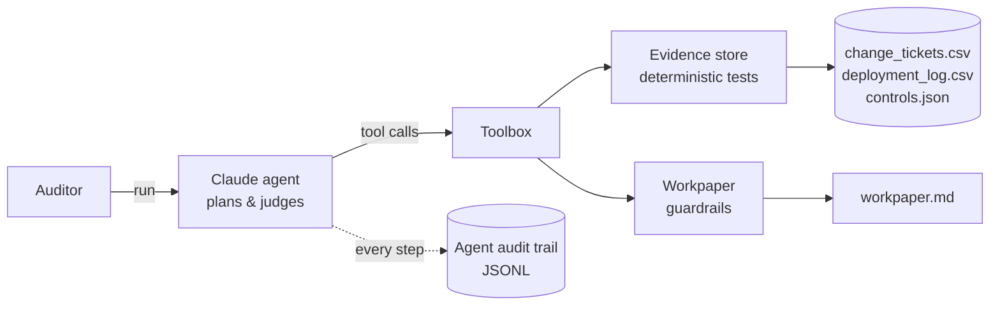

# Audit Evidence Agent

An AI agent that performs **IT General Controls (ITGC) testing of change management** — the way an IT auditor would — and produces a reviewer-ready audit workpaper.

Built with Python and the Claude API (tool use). Runs fully offline in demo mode, no API key required.


## What it does

Given a quarter's change tickets and the production deployment log, the agent:

1. **Scopes** the audit — controls, period, in-scope systems, population.
2. **Tests 100% of the population** (not a sample) against five controls.
3. **Investigates exceptions** by pulling ticket and deployment records.
4. **Writes findings** in the standard *condition / criteria / effect / recommendation* format, with severity ratings.
5. **Concludes** on operating effectiveness and produces a Markdown workpaper.

| Control | Test |
|---|---|
| CM-01 Change authorization | Approver recorded; standard changes approved *before* deployment; emergency changes approved within 2 business days |
| CM-02 Segregation of duties | Developer ≠ approver, developer ≠ deployer |
| CM-03 Testing / UAT | Test or UAT evidence attached |
| CM-04 Emergency PIR | Post-implementation review within 2 business days |
| CM-05 Completeness | Every production deployment traces to a valid ticket (detects unauthorized changes) |

## Architecture



**Design choices that matter in an audit context**

- **The LLM never computes a test result.** Every pass/fail comes from plain, reviewable Python in [`agent/evidence.py`](agent/evidence.py), so results are reproducible and can be re-performed by a reviewer. The model plans the work, investigates and writes.
- **Guardrails against hallucinated findings.** `record_finding` rejects any evidence reference that a test did not actually flag, and the workpaper cannot be finalized while any control is untested or any exception is left unaddressed.
- **The agent audits itself.** Every model reasoning step and tool call is written to an append-only JSONL audit trail (`output/agent_audit_trail.jsonl`) — supporting review, explainability and AI governance expectations.
- **Human in the loop.** The workpaper is labelled AI-assisted and requires reviewer sign-off.

## Quick start

```bash
git clone https://github.com/prasanthbabu87/audit-evidence-agent.git
cd audit-evidence-agent
pip install -r requirements.txt

# Offline demo — scripted planner driving the same tools, no API key
python main.py --offline

# Full agent with Claude
export ANTHROPIC_API_KEY=sk-ant-...
python main.py                      # optional: --model <model-id>

pytest -q                           # 12 tests
```

Output lands in `output/`. A pre-generated example is in [`sample_output/workpaper.md`](sample_output/workpaper.md).

## Sample result

The included synthetic dataset (30 tickets, 32 deployments, Q3 2026) contains planted control failures. The agent finds all of them:

| Control | Population | Exceptions |
|---|---:|---:|
| CM-01 | 30 | 2 — one approved 26h after go-live, one never approved |
| CM-02 | 30 | 2 — a self-approval and a developer deploying own code |
| CM-03 | 30 | 1 — no UAT evidence |
| CM-04 | 3 | 2 — PIR missing / 5 business days late |
| CM-05 | 32 | 2 — deployment with no ticket, deployment citing a non-existent ticket |

## Project structure

```
agent/
  evidence.py     # data loading + deterministic control tests
  tools.py        # tool schemas exposed to Claude + dispatcher
  workpaper.py    # findings, guardrails, Markdown rendering
  llm_agent.py    # Claude tool-use loop + JSONL audit trail
  offline.py      # scripted demo planner
data/             # synthetic evidence (no real data)
tests/            # pytest suite incl. mocked-LLM loop test
main.py           # CLI
```

## Extending

- Point `--data` at your own exports (same CSV columns) to test a real population.
- Add a control: add it to `controls.json`, implement a `_test_*` method in `evidence.py`, register it in `test_control`.

## Disclaimer

All data is synthetic. This is a portfolio project demonstrating agentic AI applied to IT audit; it is not a substitute for professional audit judgement.
